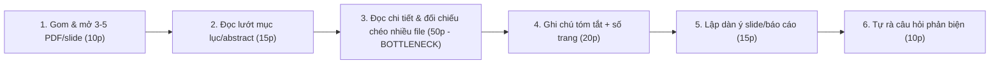
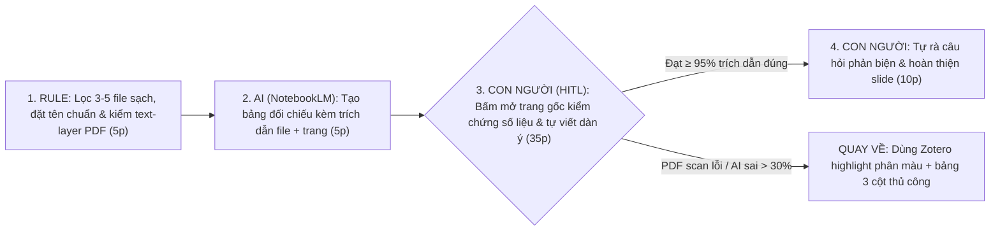

# Báo cáo nhóm — Day 02 Discovery & Problem Framing

## 1. Thông tin nhóm

- Tên nhóm: Cá nhân (làm độc lập)
- Thành viên: xem `TEAM.md` (Nguyễn Mạnh Quyền — 2A202603518)
- Candidate problem được chọn (1 câu): Sinh viên gặp bottleneck mất ~50 phút (trong tổng ~120 phút) khi phải đọc và đối chiếu luận điểm, số liệu, thuật ngữ giữa 3–5 tài liệu PDF/slide dài để lập dàn ý seminar/báo cáo mà vẫn đảm bảo đúng nguồn gốc.
- Quyết định cuối: **Not Yet**

---

## 2. Hội tụ nhóm (CP3)

### 2.1. Pitch

| # | Người đưa ra | Candidate (Job Story ngắn) | Actor | Bottleneck | Câu hỏi tự phản biện |
|---:|---|---|---|---|---|
| 1 | Nguyễn Mạnh Quyền | Rà checklist cấu trúc trước khi nộp lab để không bị trừ điểm oan | Sinh viên nộp lab | Đối chiếu chéo 3–4 file hướng dẫn (20–30') | Vấn đề này chỉ cần tạo 1 checklist tĩnh dùng lại là xong, có đủ chiều sâu so sánh các mức AI không? |
| 2 | Nguyễn Mạnh Quyền | Trích xuất luận điểm, số liệu và số trang từ 3–5 PDF/slide dài để lập dàn ý seminar | Sinh viên chuẩn bị seminar/báo cáo | Đọc chi tiết & đối chiếu giữa các file (50') | Nếu dùng AI tóm tắt hộ, làm sao tránh việc sinh viên hiểu nông khi bị hỏi vặn trực tiếp? |
| 3 | Nguyễn Mạnh Quyền | Khoanh vùng nguyên nhân gốc từ log lỗi khi cài môi trường lab | Sinh viên / thực tập sinh IT | Đọc log dài & dò issue rời rạc (25') | Lỗi phụ thuộc OS và phiên bản máy mỗi người rất khác nhau, có đo được baseline ổn định không? |
| 4 | Nguyễn Mạnh Quyền | Tìm thông báo đổi deadline và sửa đề mới nhất bị trôi trong kênh chat lớp | Sinh viên theo dõi môn học | Lội lịch sử chat nhiều tin nhắn nhiễu (9'/lần) | Có phải chỉ cần lập 1 kênh `#announcements` chỉ đọc (No AI) là giải quyết xong? |
| 5 | Nguyễn Mạnh Quyền | Gom đầu việc từ lịch sử commit và ghi chú rời rạc để viết báo cáo tuần | Sinh viên làm đồ án / thực tập | Rà lại commit & ghi chú cả tuần (35–45') | Quá giống bài mẫu báo cáo tuần của PM, đồng thời commit cá nhân thường thiếu ngữ cảnh khó khăn? |
| 6 | Nguyễn Mạnh Quyền | Hệ thống hóa câu hỏi ôn thi kèm số trang từ slide, giáo trình và đề cương | Sinh viên ôn thi | Gom và lập mục lục ôn từ nhiều file (60–90') | Tần suất chỉ xảy ra 1–2 lần/kỳ, có khó kiểm chứng lặp lại trong pilot 2 tuần không? |
| 7 | Nguyễn Mạnh Quyền | Tóm tắt nội dung đã chốt cho thành viên vắng buổi học/họp nhóm | Nhóm trưởng / thành viên | Giải thích lặp lại cho từng người (15–25') | Có thể giải quyết bằng quy ước ghi biên bản ngắn 5 gạch đầu dòng cuối buổi họp không? |
| 8 | Nguyễn Mạnh Quyền | Rút gọn báo cáo dài 5–10 trang thành 5–7 ý nói cho buổi chấm lab dưới 3 phút | Sinh viên chuẩn bị vấn đáp | Tóm tắt chính bài mình làm (40–50') | Nếu tự mình viết báo cáo đó thì bước tóm tắt lại liệu có thực sự là nỗi đau lớn? |

### 2.2. Cluster

| Cluster | Các candidate | Pattern chung |
|---|---|---|
| A — Đọc hiểu & tổng hợp nhiều tài liệu dài | #2 (Đối chiếu PDF/slide seminar), #6 (Ôn thi nhiều nguồn), #8 (Rút gọn báo cáo bảo vệ) | Phải đọc lượng lớn văn bản từ nhiều file rồi rút gọn lại kèm vị trí nguồn kiểm chứng |
| B — Tuân thủ cấu trúc & kiểm tra trước nộp | #1 (Checklist nộp lab) | Đối chiếu bài làm với tập quy tắc/tiêu chí cố định của đề bài |
| C — Gom thông tin rải rác & xử lý sự cố vận hành | #3 (Lỗi môi trường lab), #4 (Tin nhắn trôi trong chat), #5 (Gom log báo cáo tuần), #7 (Tóm tắt cho người vắng) | Dữ liệu cập nhật nằm rời rạc ở log, kênh chat hoặc ghi chú, tốn công lọc nhiễu |

### 2.3. Opportunity Solution Tree rút gọn

Gốc là **1 outcome**. Nhánh là **opportunity** (nhu cầu, pain), không phải tính năng hay công cụ.

```text
OUTCOME: Giảm thời gian sinh viên chuẩn bị dàn ý chính xác từ nhiều tài liệu PDF/slide dài trước buổi seminar mà vẫn nắm chắc nguồn gốc kiến thức
├── Opportunity A: Đọc và đối chiếu luận điểm, số liệu rải rác giữa 3–5 tài liệu PDF/slide (nhiều tiếng Anh) tốn quá nhiều thời gian trước hạn
├── Opportunity B: Khó truy ngược nhanh một nhận định hoặc số liệu nằm ở đúng trang nào, tài liệu nào để kiểm tra lại
└── Opportunity C: Dễ bị bỏ sót điều kiện giới hạn đi kèm của số liệu gốc khi chuyển ý vào dàn ý thuyết trình
```

Những ý đã gạch bỏ vì là solution đội lốt opportunity:

- ~~"Chatbot hỏi đáp và đọc hiểu hết tài liệu PDF giúp sinh viên"~~ (solution trá hình)
- ~~"Công cụ AI tự sinh trọn bộ slide PowerPoint từ các file bài giảng"~~ (solution trá hình, đồng thời làm người học mất khả năng làm chủ nội dung)

### 2.4. Chấm điểm shortlist (1–5)

| Candidate | Actor rõ | Quy trình rõ | Pain có bằng chứng | Impact đo được | Vừa sức lab | So sánh được No AI/Rule/Workflow/Agent | Hiểu domain | Tổng |
|---|---:|---:|---:|---:|---:|---:|---:|---:|
| #2 Tổng hợp & đối chiếu PDF/slide seminar | 5 | 5 | 4 | 5 | 5 | 5 | 5 | **34** |
| #3 Khoanh vùng lỗi môi trường lab | 4 | 4 | 4 | 3 | 3 | 4 | 5 | 27 |
| #4 Tra cứu tin nhắn thông báo trôi | 5 | 4 | 4 | 3 | 4 | 3 | 5 | 28 |

**Candidate được chọn:** **#2 — Tổng hợp & đối chiếu nhiều tài liệu PDF/slide dài để chuẩn bị seminar/báo cáo.**

**Vì sao chọn:** Có quy trình 6 bước cụ thể, bottleneck tập trung rõ ở bước đọc & đối chiếu chéo (`50'/120'`), đo được cả thời gian lẫn độ chính xác trích dẫn nguồn, và đặt ra bài toán ranh giới rất thực tế giữa No AI (Zotero + template) với Workflow (AI gắn nguồn + người học tự kiểm trang gốc).

**Vì sao loại các candidate còn lại:**

- **Loại #4 (Tra cứu tin nhắn thông báo trôi):** Dù rất phổ biến, bản chất vấn đề giải quyết triệt để nhất bằng sửa quy ước quản trị kênh lớp (kênh `#announcements` chỉ đọc + ghim tin theo tuần — mức **No AI**), ít không gian phân tích sự khác biệt giữa Rule và Workflow và phụ thuộc vào quyền admin của nhóm chat lớp.
- **Loại #3 (Khoanh vùng lỗi môi trường lab):** Nguyên nhân lỗi phụ thuộc rất nhiều vào hệ điều hành, biến môi trường, xung đột thư viện cục bộ trên từng máy, nên khó đo baseline đồng nhất và khó thiết kế bộ tiêu chí đánh giá (eval) gọn trong phạm vi buổi lab.

**Xử lý bất đồng (nếu có):** Không có (làm cá nhân do vắng buổi học; ghi nhận candidate #1 "Checklist nộp lab" vào hướng phát triển thêm cho người làm công cụ Rule kiểm tra cấu trúc repo).

---

## 3. Kiểm chứng + research giải pháp đã có (CP4)

### 3.1. Assumption Map

| # | Giả định | Loại (Value / Usability / Feasibility / Viability) | Quan trọng (1–5) | Đã có bằng chứng (1–5) | Kiểm chứng trước? |
|---:|---|---|---:|---:|---|
| 1 | Sinh viên khác cũng mất từ 90 phút trở lên và đau nhất ở bước đối chiếu ý/số liệu giữa nhiều PDF/slide | Value | 5 | 3 | ✅ Đã hỏi 2 người (1 xác nhận, 1 phản bác) |
| 2 | Người học muốn công cụ chỉ rõ vị trí trang gốc để tự kiểm tra (augment), không muốn giao hẳn việc viết slide vì sợ hỏi vặn | Value / Usability | 5 | 3 | ✅ Đã hỏi 2 người (phân hóa theo loại môn) |
| 3 | Tài liệu học tập (PDF bài báo, slide môn học) đa số có lớp chữ trích xuất được (không phải ảnh scan mờ) | Feasibility | 4 | 3 | Sau bước 1 |
| 4 | Kết hợp AI bám nguồn giúp giảm ≥ 40% thời gian lập dàn ý mà không làm giảm mức độ hiểu bài khi thuyết trình | Value / Usability | 5 | 1 | Kiểm trong pilot |
| 5 | Tài liệu môn học/nghiên cứu công khai được phép đưa vào công cụ cloud (NotebookLM) mà không vi phạm bảo mật | Viability | 3 | 3 | Rà lại điều khoản từng môn |

Giả định nhóm kiểm chứng tiếp để chuyển sang Go: hỏi thêm **1–2 sinh viên thuộc đúng phân khúc môn kỹ thuật có Q&A số liệu** nhằm củng cố **Giả định #1 và #2** sau khi thu hẹp đối tượng.

### 3.2. Kiểm chứng

Cách đã dùng: Phỏng vấn 2 sinh viên CNTT năm 3–4 từng làm seminar từ 3–5 PDF/slide trong học kỳ theo bộ 4 câu hỏi tuân thủ 3 luật *The Mom Test*:

1. *"Lần gần nhất bạn phải chuẩn bị bài thuyết trình/báo cáo từ nhiều file PDF hoặc slide tiếng Anh là khi nào? Kể lại giúp mình các bước bạn đã làm từ lúc nhận đề tới khi ra dàn ý."*
2. *"Ở lần đó, bước nào làm bạn ngán hoặc mất nhiều thời gian nhất? Bạn ước lượng mất bao nhiêu phút cho bước đó?"*
3. *"Hiện tại bạn hay dùng cách gì hay công cụ gì để xử lý đống PDF đó (dịch máy, highlight tay, ChatGPT, NotebookLM...)? Có chỗ nào dùng xong vẫn thấy bất tiện hoặc không yên tâm không?"*
4. *"Lúc lên trình bày trước giảng viên/nhóm, có bao giờ bạn bị thiếu chi tiết hoặc nhớ nhầm số liệu từ tài liệu gốc không? Lần đó xử lý sao?"*

Interview snapshot 1:

| Trường | Giả thuyết cần kiểm chứng | Nội dung |
|---|---|---|
| Người được hỏi (vai trò, không ghi tên thật) | Sinh viên CNTT năm 3–4 từng làm seminar từ 3–5 PDF/slide trong học kỳ này | Nam, sinh viên năm 3 CNTT. Mới làm seminar môn Mạng máy tính tuần trước, tổng hợp từ 4 paper tiếng Anh |
| Câu nói đáng nhớ nhất (nguyên văn) | — | *"Sợ nhất là chém gió nhầm số liệu từ paper này sang paper kia, lúc Q&A thầy vặn lại không biết mở trang nào ra def (phòng thủ)."* |
| Lần gần nhất gặp vấn đề này: chuyện gì đã xảy ra? | Kể được lần cụ thể, có môn và thời điểm | Tối thứ 5 tuần trước, làm slide so sánh các giao thức mạng; phải tổng hợp ưu/nhược điểm từ 4 file khác nhau |
| Hiện đang xử lý bằng cách nào (workaround)? | Dịch máy, highlight tay, hỏi ChatGPT hoặc NotebookLM rồi tự dò lại | Ném cả 4 file vào NotebookLM để lấy ý chính; sau đó mở lại từng PDF gốc, `Ctrl+F` từng keyword để tìm đoạn/trang gốc nhằm cắt hình và bảng biểu đưa vào slide |
| Mất bao lâu, bao lần? | Bước tìm và đối chiếu ý giữa các file chiếm ~40–60' trên tổng ~120' | Tổng thời gian làm nội dung khoảng 2 tiếng; riêng việc đối chiếu chéo xem NotebookLM tóm tắt từ đoạn nào, file nào mất 45 phút |
| Insight / opportunity rút ra | Ngại nhất là không chắc mình có bỏ sót/nhớ nhầm so với tài liệu gốc | AI làm nhanh nhưng không tin 100%; áp lực lớn nhất là tính chính xác khi Q&A thuyết trình và cần biết chính xác thông tin nằm ở trang nào để đối chiếu, cắt hình/bảng |

Interview snapshot 2:

| Trường | Giả thuyết cần kiểm chứng | Nội dung |
|---|---|---|
| Người được hỏi (vai trò, không ghi tên thật) | Sinh viên CNTT năm 3–4 từng làm seminar từ 3–5 PDF/slide trong học kỳ này | Nữ, sinh viên năm 4 CNTT. Vừa làm báo cáo seminar môn Đạo đức nghề nghiệp IT (dùng 3 file slide của thầy + 2 bài báo) |
| Câu nói đáng nhớ nhất (nguyên văn) | — | *"Quăng vào ChatGPT bảo nó gạch đầu dòng ra là xong, môn này thầy cũng chỉ nghe lướt lướt thôi thời gian đâu mà soi."* |
| Lần gần nhất gặp vấn đề này: chuyện gì đã xảy ra? | Kể được lần cụ thể, có môn và thời điểm | Đầu tháng, làm slide thuyết trình nhóm; khó khăn lớn nhất là ngại đọc văn bản dài bằng tiếng Anh chuyên ngành |
| Hiện đang xử lý bằng cách nào (workaround)? | Dịch máy, highlight tay, hỏi ChatGPT hoặc NotebookLM rồi tự dò lại | Dịch bằng tiện ích trên Chrome, copy các đoạn dài vào ChatGPT yêu cầu tóm tắt thành 5 bullet points ngắn để bỏ vào slide; không dò lại file gốc |
| Mất bao lâu, bao lần? | Bước tìm và đối chiếu ý giữa các file chiếm ~40–60' trên tổng ~120' | Tìm ý bằng ChatGPT chỉ mất 15 phút; dành hơn 1.5 tiếng để chọn template Canva, chỉnh font và thêm animation cho slide |
| Insight / opportunity rút ra | Ngại nhất là không chắc mình có bỏ sót/nhớ nhầm so với tài liệu gốc | **Tín hiệu phản bác:** mối bận tâm lớn nhất là làm slide đẹp và tránh đọc nhiều chữ; tin dùng đầu ra AI vì tính chất môn học không kiểm tra khắt khe số liệu |

Phân loại tín hiệu theo từng giả thuyết:

| Dấu hiệu | Kết quả từ phỏng vấn | Phân loại |
|---|---|---|
| Bước tìm/đối chiếu tốn thời gian | Interview 1 mất 45 phút để đối chiếu; Interview 2 chỉ mất 15 phút tóm tắt bằng ChatGPT | 1 xác nhận / 1 phản bác |
| Dùng công cụ AI nhưng vẫn phải dò lại | Interview 1 dùng NotebookLM nhưng vẫn mở PDF gốc `Ctrl+F` để dò và cắt hình/bảng | 1 xác nhận (nhu cầu chỉ trang gốc) |
| Nỗi đau chính nằm ở bước khác | Interview 2 tốn hơn 1.5 tiếng cho việc thiết kế Canva và hiệu ứng slide | 1 tín hiệu phản bác |
| Cho rằng AI tóm tắt đã đủ dùng | Interview 2 dùng ChatGPT gạch đầu dòng là đủ, không đối chiếu lại file gốc | 1 tín hiệu phản bác |

Tổng hợp:

| Nguồn | Số người / số mẫu | Tín hiệu xác nhận | Tín hiệu phản bác |
|---|---:|---|---|
| Phỏng vấn bạn cùng khóa (Mom Test) | 2 | 1/2 người (Interview 1 — môn Mạng máy tính) mất 45'/120' đối chiếu ngược PDF gốc sau khi dùng NotebookLM để cắt hình/bảng và phòng thủ Q&A | 1/2 người (Interview 2 — môn Đạo đức nghề nghiệp IT) chỉ tốn 15' dùng ChatGPT, không dò lại file gốc; tốn 1.5 tiếng ở khâu thiết kế slide trên Canva |

**Nhóm đã sửa problem thế nào sau kiểm chứng:**

- **Thu hẹp `Actor` theo tính chất môn học:** Bài toán đối chiếu chính xác nguồn gốc chỉ là nỗi đau thật với **sinh viên làm seminar/báo cáo môn kỹ thuật chuyên sâu có số liệu, bảng biểu và phần Q&A hỏi vặn khắt khe** (như Interview 1). Loại trừ các môn lý thuyết nhẹ không soi số liệu gốc (như Interview 2), vì nhóm này chỉ cần tóm tắt nhanh bằng ChatGPT và đau ở bước trình bày Canva.
- **Làm rõ mục đích của việc chỉ đúng trang gốc:** Không chỉ để sinh viên tự kiểm chữ khi Q&A, mà còn giúp mở ngay đúng trang chứa **hình ảnh, biểu đồ và bảng số liệu** để cắt vào slide thay vì phải `Ctrl+F` lại từng PDF.

### 3.3. Research giải pháp đã có

| Công cụ / case / pattern | Link | Giải bước nào trong quy trình? | Điểm mạnh | Khoảng trống / rủi ro | Bài học cho bài toán |
|---|---|---|---|---|---|
| **Google NotebookLM** | https://notebooklm.google/ và https://sites.google.com/view/notebook-lm | Bước 3 & 4: Đọc tổng hợp 3–5 nguồn tải lên và tạo ghi chú / bảng đối chiếu kèm trích dẫn | Hoạt động theo cơ chế bám sát nguồn đã tải lên (source-grounded), gắn số trích dẫn trực tiếp bấm vào để mở xem đúng đoạn văn bản gốc trong file; hỗ trợ PDF, Docs, Slides, URL; Google cam kết dữ liệu cá nhân/tài liệu tải lên không dùng để huấn luyện mô hình công khai | Vẫn có nguy cơ tóm tắt thiếu điều kiện biên hoặc hiểu nhầm bảng số liệu phức tạp nếu người dùng chỉ đọc tóm tắt mà không bấm xem đoạn gốc; không đọc được tốt PDF dạng ảnh scan kém chất lượng | Thị trường đã có sẵn công cụ bám nguồn rất mạnh → **không tự code chatbot/RAG từ đầu**, chỉ dùng NotebookLM ở bước đối chiếu và giữ bước con người kiểm tra trích dẫn gốc |
| **Zotero (Built-in PDF Reader & Notes)** | https://www.zotero.org/support/pdf_reader | Bước 1, 3, 4 (phương án No AI): Mở nhiều tab PDF, highlight phân màu, cắt vùng bảng biểu và gom ghi chú kèm link nhảy về đúng trang | Hoàn toàn kiểm soát được bằng tay, miễn phí mã nguồn mở; mọi ghi chú tự động gắn liên kết ngược về đúng trang PDF gốc và chèn trích dẫn chuẩn vào Word/Google Docs/LibreOffice | Không có AI tổng hợp chéo nhiều tài liệu tiếng Anh cùng lúc, nên người học vẫn mất nhiều thời gian tự đọc từ đầu tới cuối | Dùng làm **phương án quay về (fallback)** và công cụ lưu trữ/highlight tài liệu gốc song song với bước đối chiếu |
| **Elicit (AI Research Assistant — tài liệu giới hạn chính thức)** | https://support.elicit.com/en/articles/14757928-elicit-s-limitations | Bước 3: Trích xuất bảng so sánh có trích dẫn câu gốc từ các bài báo khoa học | Giao diện bảng trích xuất từng cột biến số kèm câu trích gốc giúp đối chiếu nhanh giữa nhiều paper | Tài liệu giới hạn chính thức của Elicit nêu rõ: mô hình vẫn có thể bỏ sót ngữ cảnh hoặc hiểu sai biểu đồ/bảng phức tạp, không tự đánh giá được chất lượng phương pháp luận của bài báo, thiên về nghiên cứu thực nghiệm và giới hạn quota theo gói | Nhắc rõ rằng ngay cả công cụ chuyên sâu cho nghiên cứu cũng yêu cầu **người dùng kiểm chứng dữ liệu định lượng và chất lượng nguồn**, nên không được bỏ bước kiểm tra thủ công (HITL) |

**Kết luận research:** Đã có sẵn công cụ giải quyết tới ~75–80% phần nặng về kỹ thuật (NotebookLM bám nguồn có nhảy tới đoạn trích + Zotero quản lý PDF và trích dẫn). Do đó hướng đi đúng không phải lập trình hệ thống AI mới, mà là thiết kế **Workflow gọn nhẹ trên công cụ có sẵn** kèm quy tắc kiểm chứng bắt buộc cho sinh viên.

---

## 4. Quy trình trước/sau (CP5)

### 4.1. Quy trình hiện tại



| Bước | Actor | Input | Output | Thời gian / tần suất | Ghi chú |
|---:|---|---|---|---|---|
| 1 | Sinh viên | Yêu cầu đề bài, link/file bài giảng | Thư mục chứa 3–5 PDF/slide liên quan | 10 phút / lần | Thường 2–3 tuần/lần trước buổi seminar |
| 2 | Sinh viên | 3–5 file PDF/slide | Danh sách các chương/mục cần đọc sâu | 15 phút / lần | Tốn thêm thời gian với tài liệu tiếng Anh dài |
| 3 | Sinh viên | Các chương/mục đã lọc | Hiểu sự tương đồng, khác biệt và số liệu giữa các nguồn | **50 phút / lần** | **Bottleneck chính**: phải lật qua lại nhiều cửa sổ để đối chiếu thuật ngữ và số liệu |
| 4 | Sinh viên | Ghi nhớ rời rạc khi đọc | File nháp ghi tóm tắt + số trang nguồn | 20 phút / lần | Dễ quên ghi số trang, lúc cần kiểm lại phải tìm từ đầu |
| 5 | Sinh viên | File ghi chú nháp | Dàn ý cấu trúc slide/báo cáo | 15 phút / lần | Chưa đồng đều nếu bước 3 đọc bị mệt |
| 6 | Sinh viên | Dàn ý slide | Danh sách 3–5 câu hỏi phản biện dự kiến | 10 phút / lần | Hay bị cắt bớt nếu quá sát giờ nộp/báo cáo |

**Bottleneck chính:** **Bước 3 (50 phút / 120 phút)** — đọc chi tiết và đối chiếu thủ công luận điểm, số liệu, điều kiện phạm vi giữa nhiều tài liệu tiếng Anh dài nằm ở nhiều file khác nhau.

### 4.2. Quy trình tương lai



- **Bước Rule (Bước 1 — 5'):** Chỉ chọn đúng 3–5 file đã duyệt, đặt tên file gọn (`[A] TenTaiLieu.pdf`), kiểm tra PDF có bôi đen copy chữ được không (text-layer).
- **Bước AI hỗ trợ (Bước 2 — 5'):** Tải đúng 3–5 file vào NotebookLM và dùng prompt chuẩn xuất bảng đối chiếu theo 4 cột (`Chủ đề · Tài liệu & Trang · Ý chính · Điều kiện/Giới hạn`), yêu cầu bắt buộc trích dẫn từng ý.
- **Bước Con người kiểm tra — HITL (Bước 3 — 35'):** Sinh viên bấm vào từng số trích dẫn trong NotebookLM để đọc trực tiếp đoạn văn bản gốc trong PDF, kiểm tra số liệu/điều kiện phạm vi, rồi **tự tay viết lại dàn ý và nội dung slide** bằng ngôn ngữ của mình.
- **Boundary (AI không được làm gì):**
  1. Không dùng dữ liệu ngoài 3–5 tài liệu do người học chọn (tắt hoặc không dùng nguồn ngoài nếu không tự kiểm chứng độc lập).
  2. Không xuất luận điểm hoặc số liệu mà thiếu tên file + vị trí trích dẫn gốc.
  3. Không viết trọn bộ slide hoặc bài báo cáo để sinh viên copy nguyên văn đi trình bày/nộp.
- **Phương án quay về (Fallback):** Nếu PDF là ảnh scan mờ không đọc được chữ hoặc khi kiểm tra 10 ý đầu thấy quá 30% trích dẫn sai ngữ cảnh/sai trang → ngừng ngay bước AI, mở tài liệu bằng Zotero và đọc ghi chú theo bảng 3 cột thủ công.

### 4.3. Before / after

| Chỉ số | Trước | Sau (kỳ vọng) | Ghi chú |
|---|---:|---:|---|
| Số bước | 6 | 4 | Gộp bước lọc file + kiểm text-layer thành bước Rule rõ ràng |
| Tổng thời gian | ~120 phút | ~55 phút | Kỳ vọng giảm > 50%, mục tiêu đạt dưới 60 phút |
| Số bước thủ công | 6/6 | 2/4 (phần kiểm chứng + viết dàn ý) | Sinh viên vẫn trực tiếp đọc đoạn gốc và viết slide |
| Bottleneck chính | Đọc & đối chiếu chéo thủ công (50') | Kiểm chứng trích dẫn & tự viết dàn ý (35') | Bottleneck chuyển thành bước kiểm soát chất lượng cần thiết |
| Rủi ro mới phát sinh | — | AI gộp nhầm ngữ cảnh giữa 2 file; sinh viên lười đọc đoạn gốc dẫn đến hiểu nông khi phản biện | Kiểm soát bằng HITL bắt buộc mở trích dẫn gốc + 4 tiêu chí eval |

---

## 5. Problem Statement v0 (CP5)

| Trường | Nội dung |
|---|---|
| **Actor** | Sinh viên CNTT chuẩn bị bài thuyết trình/báo cáo seminar từ nhiều tài liệu học tập |
| **Quy trình** | Gom 3–5 file PDF/slide → đọc lướt mục lục → đọc chi tiết & đối chiếu chéo → ghi chú số trang → lập dàn ý slide → rà câu hỏi phản biện |
| **Bottleneck** | Bước đọc chi tiết & đối chiếu luận điểm, số liệu giữa 3–5 tài liệu tiếng Anh dài mất khoảng 50 phút vì phải lật qua lại nhiều file |
| **Impact** | Tốn ~120 phút/bộ tài liệu (~2–3 tuần/lần); dễ đọc lướt sót điều kiện số liệu hoặc thiếu thời gian chuẩn bị phần hỏi đáp |
| **Success Metric** (baseline → target, cách đo) | Giảm tổng thời gian chuẩn bị dàn ý từ ~120 phút (ước lượng từ quy trình hiện tại, cần tự bấm giờ 1–2 lần để khóa baseline) xuống dưới 60 phút, đo bằng sinh viên tự bấm giờ trong 2 tuần/2 bài seminar thử nghiệm |
| **Boundary** (AI không được làm gì; khi nào cần con người kiểm tra — HITL) | AI không tự tìm nguồn ngoài danh sách file đầu vào, không đưa nhận định thiếu trích dẫn vị trí gốc, không tự viết trọn bộ slide/báo cáo. Con người bắt buộc kiểm tra đối chiếu từng trích dẫn với đoạn gốc trong PDF trước khi đưa vào dàn ý |

Phản biện nhận được (từ AI đóng vai PM kiểm tra lỗ hổng) và nhận định tự chốt:

- **Lỗ hổng chỉ ra:** Success Metric ở bản v0 chỉ đo **tốc độ** (`120' → < 60'`), chưa đo **độ chính xác trích dẫn** và **mức độ tự hiểu**; đồng thời Actor chưa nêu rõ điều kiện tài liệu PDF phải đọc được text-layer. **Đồng ý** và cập nhật ở Problem Statement v1.

---

## 6. Mức can thiệp AI (CP6)

### 6.1. Ma trận độ mơ hồ × độ phức tạp

Bài của nhóm nằm ở ô: **Độ mơ hồ cao × Độ phức tạp thấp–trung bình**.

Vì sao:

- **Độ mơ hồ cao:** Cách tóm tắt và sắp xếp luận điểm giữa các tài liệu không có một khuôn mẫu đúng/sai cứng nhắc như phân loại nhãn cố định; nhiều cách diễn đạt đều hợp lệ miễn bám sát nguồn gốc.
- **Độ phức tạp thấp–trung bình:** Đầu vào giới hạn ở 3–5 file cố định do người học chọn, các bước chạy tuần tự theo một đường thẳng (`Lọc nguồn → AI lập bảng đối chiếu → Người kiểm chứng & viết dàn ý → Rà phản biện`), không cần rẽ nhánh động nhiều hệ thống.
→ Theo ma trận, **Workflow có AI ở một bước cố định** là phù hợp nhất.

### 6.2. So sánh 4 mức

| Mức | Phương án cho bài của nhóm | Đủ khi nào | Rủi ro | Chọn? |
|---|---|---|---|---|
| **No AI** (sửa quy trình) | Zotero highlight phân màu + template bảng 3 cột tự điền | Tài liệu ngắn (< 10 trang/file) hoặc tiếng Việt quen thuộc, hoặc khi PDF scan mờ không nhận dạng chữ | Vẫn tốn ~50' đọc đối chiếu với 3–5 PDF tiếng Anh dài | Dùng làm **fallback** |
| **Rule** | Script trích mục lục PDF (`pypdf`) + tìm kiếm theo từ khóa (`Ctrl+F`) | Chỉ cần tìm chính xác vị trí 1 từ khóa kỹ thuật cố định | Không hiểu ngữ nghĩa đồng nghĩa/diễn giải khác nhau giữa các tác giả tiếng Anh | Dùng cho **Bước 1** (kiểm text-layer/lọc file) |
| **Workflow** | Rule lọc 3–5 PDF đọc được chữ → NotebookLM tạo bảng đối chiếu kèm trích dẫn → Người kiểm đoạn gốc & viết slide | Quy trình cố định, cần đối chiếu ý nghĩa nhiều tài liệu dài mà vẫn kiểm soát được nguồn | Trích nhầm ngữ cảnh hoặc người học ỷ lại không mở đoạn gốc | **Chọn** |
| **Agent** | AI tự động tìm thêm paper mới trên mạng, tự chọn nguồn, tự tóm tắt và tự xuất file slide hoàn chỉnh | Nghiên cứu mở rộng chưa biết trước nguồn nào liên quan | Tự đưa nguồn rác/ngoài phạm vi môn học, khó kiểm chứng hết trích dẫn, mất năng lực tự hiểu khi thuyết trình | Không chọn |

**Mức chọn:** **Workflow**.

**Vì sao không chọn mức đơn giản hơn:** Rule (tìm từ khóa cố định) chỉ tìm được đoạn chứa đúng từ khóa, không gom và so sánh được hai tài liệu dùng thuật ngữ hoặc cách diễn đạt khác nhau về cùng một vấn đề; No AI (highlight Zotero) giúp quản lý trích dẫn tốt nhưng vẫn giữ nguyên bottleneck ~50 phút đọc lật qua lại 3–5 tài liệu tiếng Anh dài. Ngược lại, không lên Agent vì phạm vi nguồn đã được khóa sẵn theo bài giảng/đề tài, không cần AI tự quyết định tìm thêm tài liệu mới.

### 6.3. AI Canvas rút gọn

| Thành phần | Nội dung |
|---|---|
| **Prediction** — AI dự đoán / tạo ra gì? | Bảng đối chiếu luận điểm chính, số liệu, điều kiện phạm vi và thuật ngữ giữa 3–5 tài liệu đầu vào kèm trích dẫn nguồn |
| **Judgment** — con người cân nhắc, quyết định gì? | Đánh giá độ tin cậy của từng đoạn trích so với văn bản gốc PDF; chọn ý nào thực sự cần đưa lên slide và giải thích theo logic thuyết trình |
| **Action** — hành động cuối cùng là gì, ai làm? | Sinh viên tự viết dàn ý, thiết kế slide và chuẩn bị câu trả lời phản biện |
| **Outcome** — đo kết quả bằng gì? | Tổng thời gian lập dàn ý (`< 60'`), tỷ lệ trích dẫn đúng file/trang (`≥ 95%`), tỷ lệ ý phải đọc lại từ đầu vì AI hiểu sai |
| **Input** — AI cần dữ liệu đầu vào gì mỗi lần chạy? Có sẵn không? | 3–5 file PDF/slide có lớp text trích được + 3–4 câu hỏi trọng tâm cần đối chiếu của buổi seminar. Có sẵn từ tài liệu môn học |
| **Feedback** — lấy phản hồi ở đâu để cải thiện? | Nhật ký kiểm tra trích dẫn sai/thiếu trang của sinh viên sau mỗi buổi seminar và câu hỏi sinh viên trả lời vấp khi thuyết trình |

### 6.4. Hai câu hỏi của Google PAIR

- Người dùng muốn **được hỗ trợ (augment)** hay **giao hẳn việc (automate)**? Bằng chứng: Kết quả phỏng vấn CP4 cho thấy sự phân hóa theo môn học: với môn kỹ thuật có Q&A gắt (Interview 1), người dùng vẫn phải tự kiểm PDF gốc để cắt hình/bảng và tự phòng thủ câu hỏi nên cần **Augment** (chỉ rõ trang & đoạn trích); trong khi môn lý thuyết nhẹ (Interview 2) có xu hướng giao hẳn cho AI tóm tắt nhanh. Do đó giải pháp được thiết kế theo hướng **Augment** và giới hạn phạm vi ở nhóm môn kỹ thuật có yêu cầu đối chiếu cao.
- AI sai kiểu nào tệ hơn, **báo nhầm** hay **bỏ sót**? Vì sao, và thiết kế đã xử lý thế nào: **Báo nhầm (bịa nhận định, gán nhầm số liệu/số trang hoặc bỏ mất điều kiện giới hạn của nghiên cứu)** tệ hơn bỏ sót một ý phụ, vì trích sai nguồn kiến thức trước giảng viên/hội đồng làm mất độ tin cậy toàn bài. Thiết kế xử lý bằng việc bắt buộc dùng công cụ bám nguồn có link nhảy tới đoạn gốc (NotebookLM), cấm dùng nguồn ngoài và quy định bước HITL tự mở kiểm tra lại mọi số liệu trước khi đưa lên slide.

---

## 7. Problem Statement v1 + tiêu chí đánh giá (CP6)

| Trường | Nội dung |
|---|---|
| **Actor** | Sinh viên CNTT chuẩn bị bài thuyết trình/báo cáo **môn kỹ thuật chuyên sâu có số liệu, bảng biểu và phần Q&A hỏi vặn khắt khe**, sử dụng tài liệu PDF/slide có thể trích xuất văn bản (text-layer) |
| **Quy trình** | Lọc 3–5 file sạch & kiểm text-layer → AI lập bảng đối chiếu kèm trích dẫn trang → Sinh viên kiểm chứng đoạn gốc, cắt hình/bảng & tự viết dàn ý → Rà câu hỏi phản biện |
| **Bottleneck** | Đọc chi tiết & đối chiếu luận điểm, số liệu giữa 3–5 tài liệu tiếng Anh dài (mất ~45–50 phút kể cả khi đã tóm tắt bằng NotebookLM nhưng phải `Ctrl+F` lại từng PDF) |
| **Impact** | Tốn ~120 phút/bộ tài liệu; tăng nguy cơ nhầm số liệu giữa các paper khi giảng viên hỏi Q&A hoặc sót bảng/hình minh họa |
| **Success Metric** (baseline → target, cách đo) | (1) Tổng thời gian lập dàn ý từ ~120 phút xuống dưới 60 phút (tự bấm giờ); (2) Tỷ lệ trích dẫn đúng file & đúng vị trí trang ≥ 95%; (3) Số câu hỏi phản biện bị trả lời sai kiến thức gốc = 0 khi tự đối chiếu lại tài liệu |
| **Boundary** | AI không tìm hay trộn kiến thức từ ngoài 3–5 file đầu vào, không đưa nhận định thiếu trích dẫn trang gốc, không viết trọn bộ slide/bài nộp |
| **AI intervention point** | Ngay sau khi sinh viên lọc xong 3–5 file nguồn sạch có text-layer, trước bước sinh viên đọc kiểm chứng, cắt hình/bảng và tự viết dàn ý |
| **Mức chọn** | Workflow |
| **Rủi ro & người kiểm tra** | Rủi ro gộp nhầm ngữ cảnh, sai đơn vị số liệu, bỏ sót điều kiện mẫu hoặc PDF scan mờ → **Sinh viên tự kiểm tra từng đoạn trích dẫn trên file gốc PDF trước khi đưa vào dàn ý** |

**Thay đổi so với v0 và lý do:**

| Trường | v0 | v1 | Vì sao đổi |
|---|---|---|---|
| **Actor** | Sinh viên CNTT chuẩn bị seminar từ nhiều tài liệu | Thu hẹp còn *"môn kỹ thuật chuyên sâu có số liệu, bảng biểu và Q&A khắt khe"* + PDF có text-layer | Phỏng vấn CP4 cho thấy môn nhẹ (Interview 2) chỉ mất 15' dùng ChatGPT và không cần kiểm trang gốc; chỉ môn kỹ thuật có Q&A (Interview 1) mới đau ở bước đối chiếu trang (`45'/120'`) |
| **Success Metric** | Chỉ đo tổng thời gian (`120' → < 60'`) | Bổ sung độ chính xác trích dẫn trang (`≥ 95%`) và không sai kiến thức gốc (`= 0`) | Tiếp thu phản biện AI: làm nhanh hơn nhưng sai số liệu/trích dẫn thì gây hại hơn làm chậm khi Q&A |

**Tiêu chí đánh giá đầu ra của AI (4 tiêu chí):**

| # | Tiêu chí | Đạt khi | Không đạt khi |
|---:|---|---|---|
| 1 | Đúng nguồn & vị trí trang | Mọi luận điểm/số liệu đều gắn đúng tên file và đúng số trang/slide | Thiếu tên file/trang hoặc trỏ nhầm sang trang/file khác |
| 2 | Không bịa ngoài tài liệu | Chỉ dùng thông tin nằm trong 3–5 file đầu vào; phần thiếu ghi rõ *"Không có trong nguồn"* | Chèn kiến thức bên ngoài hoặc tự ước lượng số liệu cho đủ bảng |
| 3 | Giữ đúng thuật ngữ & điều kiện | Giữ thuật ngữ tiếng Anh chuẩn và giữ nguyên điều kiện giới hạn đi kèm số liệu (cỡ mẫu, đơn vị, phạm vi) | Dịch mất thuật ngữ chuyên môn hoặc làm tròn/cắt bỏ điều kiện giới hạn |
| 4 | Cấu trúc bảng đối chiếu gọn | Tách rõ từng ý thành bảng ngắn gọn (Chủ đề · Nguồn & Trang · Ý chính · Điều kiện), kiểm lại được trong 2–3 phút | Viết thành khối văn dài lan man khó đối chiếu nhanh |

**Bộ 10 cặp eval mẫu kiểm thử chi tiết theo 4 tiêu chí trên:** xem [cp6-eval-samples.md](../assets/cp6-eval-samples.md).

---

## 8. Quyết định (CP6)

### 8.1. Bốn rủi ro

| Rủi ro | Câu hỏi | Mức độ rủi ro (Thấp = an toàn / TB / Cao = nguy hiểm) | Lý do / bằng chứng |
|---|---|---|---|
| **Value** | Người dùng có thật sự cần và sẽ dùng không? | **Cao** | Đã phỏng vấn 2 bạn: Interview 1 xác nhận rõ pain 45'/120' ở môn kỹ thuật có Q&A, nhưng Interview 2 phản bác ở môn lý thuyết nhẹ (chỉ tốn 15' ChatGPT). Trên phân khúc môn kỹ thuật vừa thu hẹp mới chỉ có 1 mẫu xác nhận, chưa đủ độ tin cậy để chốt Go |
| **Usability** | Người dùng có dùng được, có hiểu và sửa được đầu ra của AI không? | **Thấp** | NotebookLM hỗ trợ tải file và bấm trực tiếp vào số trích dẫn để xem đoạn gốc; Interview 1 đã dùng được NotebookLM nhưng vẫn gặp bất tiện khi phải `Ctrl+F` ngược lại PDF |
| **Feasibility** | Có đủ dữ liệu, công cụ, kỹ năng để làm không? | **Thấp** | Công cụ (NotebookLM, Zotero) miễn phí, có sẵn và đã kiểm chứng hoạt động; chỉ cần PDF có lớp chữ |
| **Viability** | Có hợp chi phí, pháp lý, quy định tổ chức không? Ai vận hành? | **Thấp – Trung bình** | Dùng với tài liệu môn học/nghiên cứu công khai không tốn phí; cần tránh đưa tài liệu nội bộ/bảo mật của doanh nghiệp khi thực tập lên dịch vụ cloud công cộng |

### 8.2. Kết luận

**Quyết định:** **Not Yet**

**Lý do:** Dù Interview 1 xác nhận đúng nỗi đau (`45'/120'`) và hỗ trợ thu hẹp bài toán về đúng phân khúc môn kỹ thuật có Q&A số liệu, cỡ mẫu thực tế hiện mới có 2 người (trong đó chỉ 1 người thuộc phân khúc mục tiêu mới thu hẹp). Do đó rủi ro **Value** vẫn giữ ở mức **Cao** cho tới khi hỏi thêm được ít nhất 1–2 sinh viên thuộc đúng nhóm môn kỹ thuật.

**Nếu Go — pilot nhỏ nhất (chỉ kích hoạt sau khi vượt qua bước kiểm chứng bên dưới):**

- Không xây dựng phần mềm mới. Áp dụng Workflow trong **2 tuần** (hoặc 2 bài chuẩn bị seminar môn kỹ thuật): lọc 3–5 PDF đọc được chữ → nạp vào NotebookLM với prompt chuẩn bảng đối chiếu kèm số trang/hình/bảng → tự bấm giờ toàn bộ quy trình và chấm 100% các ý trích dẫn theo 4 tiêu chí eval ở mục 7.

**Nếu Not Yet — cần kiểm chứng gì trước:**

1. Hỏi thêm **1–2 sinh viên làm seminar môn kỹ thuật có Q&A số liệu** (ví dụ Mạng máy tính, Hệ điều hành, An toàn thông tin) bằng bộ 4 câu hỏi *The Mom Test* ở mục 3.2 để kiểm tra xem bước dò ngược trang gốc có phổ biến trong đúng phân khúc vừa thu hẹp không.
2. Tự bấm giờ thật **1 lần** quá trình đọc 3 tài liệu thủ công bằng Zotero/PDF viewer để khóa con số baseline chính xác thay cho ước lượng `120'` ban đầu.
3. Nếu tổng số xác nhận ở nhóm môn kỹ thuật đạt **≥ 2/3** → chuyển sang **Go, phạm vi nhỏ** (chạy pilot 2 tuần). Nếu đa số thấy NotebookLM hiện tại đã đủ hoặc không đau ở bước dò trang → chuyển sang **No-Go**.

**Nếu No-Go — nên làm gì thay AI:**

- Sử dụng **Zotero PDF Reader** với quy ước highlight 3 màu (định nghĩa, số liệu, kết luận) + template bảng đối chiếu 3 cột cố định để chuẩn hóa việc ghi số trang ngay từ lần đọc đầu tiên.

**Ngưỡng dừng** (khi chuyển sang pilot): nếu sau **2 bài seminar thử nghiệm** mà tỷ lệ trích dẫn sai trang/ngữ cảnh vượt quá **20%**, hoặc tổng thời gian (gồm cả khâu kiểm chứng lại) vẫn lớn hơn **85 phút** (giảm dưới 30% so với baseline), thì dừng Workflow AI và quay về phương án **Zotero + bảng đối chiếu 3 cột**.

---

## 9. Hạn chế và hướng tiếp theo

- **Hạn chế lớn nhất hiện tại:** Làm cá nhân sau buổi học nên chưa có phản biện chéo trực tiếp từ đồng đội; mẫu phỏng vấn ở mục 3.2 mới dừng ở **2 người** (chỉ 1 người thuộc phân khúc môn kỹ thuật vừa thu hẹp) và baseline `120'` ở CP1–CP2 vẫn là ước lượng theo trí nhớ.
- **Hướng tiếp theo:**
  1. Hỏi thêm 1–2 sinh viên chuẩn bị seminar môn kỹ thuật để nâng tổng mẫu phỏng vấn CP4 lên 3–4 người trước khi chuyển sang pilot.
  2. Bấm giờ thực tế 1 lần quá trình chuẩn bị seminar bằng quy trình cũ để khóa baseline thay cho ước lượng trí nhớ.
  3. Xác nhận với Key Coach về hình thức nộp cá nhân và tên repo (`Day02` hay `DAY02`).

## 10. Tài liệu tham khảo

- Google NotebookLM (trang chính thức và giới thiệu tính năng bám nguồn): https://notebooklm.google/ và https://sites.google.com/view/notebook-lm
- Zotero PDF Reader & Notes Documentation: https://www.zotero.org/support/pdf_reader
- Elicit Official Limitations Documentation: https://support.elicit.com/en/articles/14757928-elicit-s-limitations
- Tài liệu hướng dẫn và framework của lab: [docs/01-worksheet.md](../../docs/01-worksheet.md), [docs/03-international-frameworks.md](../../docs/03-international-frameworks.md)
